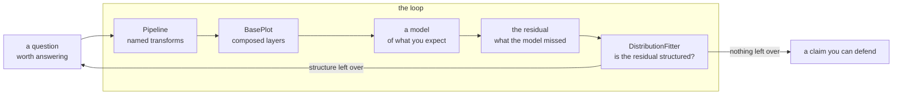

# GOAD🐐 documentation

GOAD is **Goal Oriented Analysis of Data**. The name is the method: an analysis starts with
a question, and every transform, plot and test that follows is judged by whether it moves
that question closer to an answer somebody else would accept.

The library exists because that method has a shape, and the shape is worth making into code:

- a **pipeline** of named, reusable transforms, so the path from raw file to the frame you
  plotted is legible instead of scattered across forty notebook cells;
- **plots that compose**, so a plot and its makeup are separate things and a chart can be
  built up one deliberate layer at a time rather than configured in one enormous call;
- **distribution fitting with its diagnostics attached**, so "this looks roughly normal" can
  be replaced by a fit, a test, and a picture of both.

None of these are impressive on their own. What makes them useful is that all three are
extendable by subclassing one small base class, so the answer to "GOAD doesn't do the thing I
need" is fifteen lines of your own, not a fork.

---

## Reading order

| # | Document | What it covers |
|---|---|---|
| 1 | [Goal oriented analysis](01-goal-oriented-analysis.md) | What the method is, the question-first loop, and why the residual is the finding |
| 2 | [Pipelines](02-pipelines.md) | `TransformBase`, `Pipeline`, `DataProcessor`, and writing your own transform |
| 3 | [Plot composition](03-plot-composition.md) | `BasePlot`, `PlotSettings`, `plot_on`, and separating a plot from its makeup |
| 4 | [The five families](04-five-families.md) | Categories, time, distributions, relations, high-dimensional: what each answers and how each lies |
| 5 | [Distributions](05-distributions.md) | The registry, `DistributionFitter`, KS versus log-likelihood, reading `PlotFits` |
| 6 | [Models and residuals](06-models-and-residuals.md) | Fitting a model by hand, and treating what is left over as the result |
| 7 | [Visual critique](07-visual-critique.md) | Preattentive processing, gestalt principles, the five guidelines, applied as a checklist |
| 8 | [API reference](08-api-reference.md) | Compact signature tables for everything the package exports |
| 9 | [The analysis method](09-analysis-method.md) | The ordered method: from a question to a claim you can defend, in the order the steps must happen |
| 10 | [Teaching path](10-teaching-path.md) | Lesson-by-lesson course map, and the question each lesson is built to provoke |

If you are **starting out**: read [Goal oriented analysis](01-goal-oriented-analysis.md),
then run `demo/linear.py`, then keep [API reference](08-api-reference.md) open as a lookup
table.

If you are **stuck on which plot to make**: [The five families](04-five-families.md) sorts
that by the question you are asking, not by the chart type you already had in mind.

If you have **a plot and want to know whether it is any good**:
[Visual critique](07-visual-critique.md).

If you have **data and no idea where to start**: [The analysis method](09-analysis-method.md)
is the ordered version, and the `goad_analysis_checklist` MCP tool walks it with you one
stage at a time.

---

## The shape of the whole thing



The arrow back to the top is the point. An analysis that runs the loop once and reports the
first plot has not finished; it has started. What the model failed to explain is where the
next question lives.

---

## Package layout

```
src/goad_toolkit/
├── config.py           # FileConfig, DataConfig — pydantic settings
├── filehandler.py      # FileHandler: download / load / save
├── datatransforms.py   # TransformBase + ShiftValues, DiffValues, SelectDataRange,
│                       # RollingAvg, ZScaler, and the Pipeline that chains them
├── dataprocessor.py    # DataProcessor: a FileHandler and a Pipeline, wired together
├── distributions.py    # Distribution, DistributionRegistry
├── analytics.py        # DistributionFitter, FitResults, FitResult, FailedFit, KSTestResult
├── models.py           # linear_model, logistic, mse, train_model
├── visualizer.py       # PlotSettings + BasePlot and its subclasses, PlotFits
└── cli.py              # the `goad` command: fit the registry to one column
```

Plus, outside the package:

- `demo/linear.py` — the whole loop in one runnable script, on covid data
- `docs/` — these chapters
- `goad_mcp.py` — the MCP server that serves these chapters as a coaching conversation
  (see [MCP_SERVER.md](../MCP_SERVER.md))
